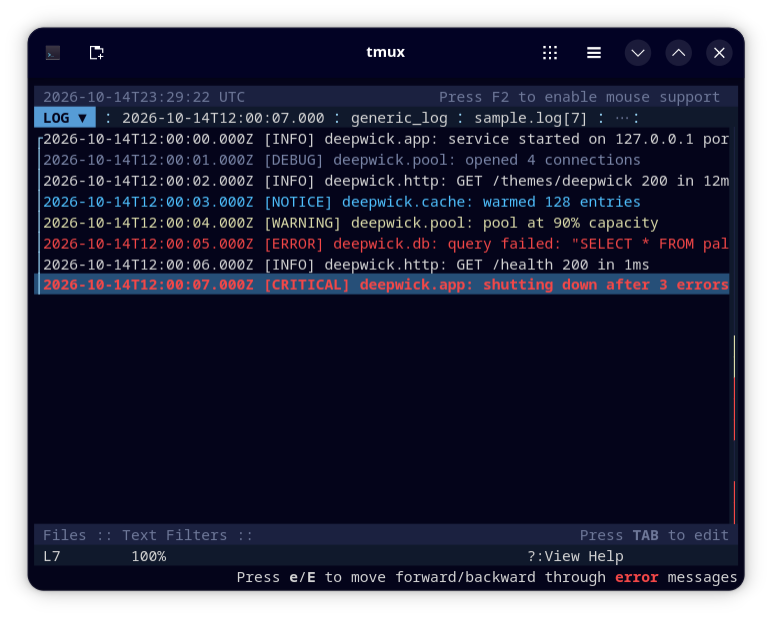

# Deepwick for lnav

Deepwick colors for [lnav](https://lnav.org).

> Deepwick is an unofficial theme derived from
> [Polywick Blue](https://vscode.polywickstudio.net) by Polywick Studio (MIT).
> Not affiliated with Polywick Studio.



## Install

```sh
mkdir -p ~/.config/lnav/configs/deepwick
cp deepwick.json ~/.config/lnav/configs/deepwick/
```

## Activate

Inside lnav:

```
:config /ui/theme deepwick
```

lnav saves the setting, so you only do this once.

## Notes

- lnav's SQL help popup (shown while typing a `;` query) draws SQL keywords in
  a fixed 256-color blue that themes can't change.
- Colors need a terminal with 24-bit color.
- Log levels follow the Deepwick diagnostics colors: errors Red (critical
  and fatal bold), warnings Yellow, notices Cyan, debug Comment, trace and
  debug2–5 Muted.
- SQL and other syntax follow the Deepwick syntax roles: keywords Blue,
  strings Orange, numbers Sage, comments Comment italic.
- lnav's default theme colors IP addresses and XML tags with a different
  hash-picked color for each value. Deepwick uses fixed colors instead: IPv4
  addresses Cyan, XML tags Blue.
- The status bar title is Background on Blue; panels and popups sit on
  Surface.

Tested with lnav 0.13.2.

## License

MIT. See [LICENSE](LICENSE).
